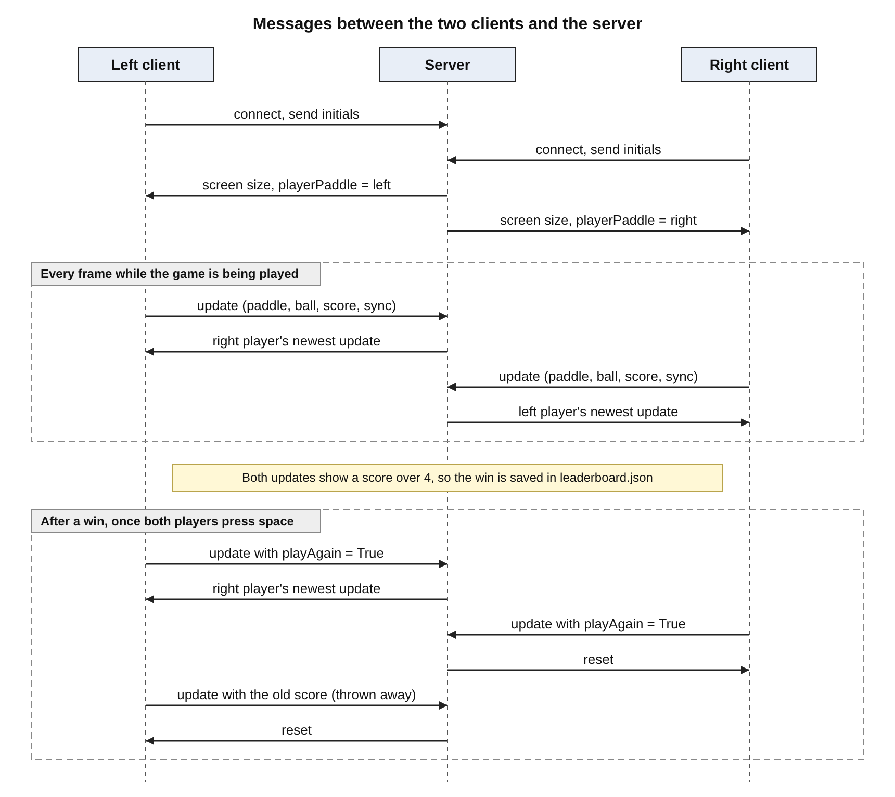

Implementation
==============

This is the draft of the Implementation section of the final report. The server parts match
`pongServer.py` as it is now. The client's update each frame is written the way the team agreed on
it, so it should be checked against the final client code before the report is turned into a PDF.

Files
-----

| File | What it does |
| --- | --- |
| `src/pongServer.py` | Accepts the two players, passes each player's updates to the other, handles the rematch, saves wins and serves the leaderboard webpage |
| `src/pongClient.py` | Shows the start screen, connects to the server and runs the game for one player |
| `src/networkHelpers.py` | `sendMessage` and `receiveMessage`, used by both programs so they send and read messages the same way |
| `src/assets/code/helperCode.py` | The provided `Paddle` and `Ball` classes and the `updateScore` function |

Server functions
----------------

| Function | Purpose |
| --- | --- |
| `loadWins()` | Reads `leaderboard.json` and returns a dictionary of initials to wins. Returns an empty dictionary if the file does not exist yet |
| `recordWin(playerInitials)` | Adds one win for a player and saves the file |
| `findWinner(update, opponentUpdate)` | Returns `"left"` or `"right"` if both players' updates show that side with more than 4 points, otherwise `""` |
| `handleClient(conn, side)` | Runs in its own thread for one client. Receives that client's update every frame and sends back one reply |
| `LeaderboardHandler.do_GET()` | Builds the leaderboard page and sends it to the web browser |
| `startLeaderboard()` | Starts the web server in its own thread on port 80, or on port 8080 if port 80 cannot be opened |

Message diagram
---------------

The diagram shows the order of the messages for one game followed by a rematch.



Server pseudocode
-----------------

Starting up:

```
create a TCP socket, bind it to 0.0.0.0 port 19999 and listen
start the leaderboard web server in its own thread

for side in "left", "right":
    wait for a client to connect
    receive the client's initials and remember them for this side
    remember the client until both players have joined

for each of the two clients:
    send the screen width, screen height and paddle side to the client
    start a thread that runs handleClient for this client

wait for both threads to finish
```

`handleClient`, which runs once for each player:

```
repeat forever:
    receive this player's update

    take the lock
        if this player still has to be told about a rematch:
            throw the update away, because it holds the old winning score
            reply = reset
        else:
            save the update as this player's newest update

            if no win has been saved for this game and findWinner names a winner:
                add one win for the winner's initials and save leaderboard.json
                remember that this game has been counted

            if the update asks to play again:
                add this player to the play again votes

            if both players have voted to play again:
                clear the votes, both saved updates and the "game counted" flag
                remember that the other player still has to be told
                reply = reset
            else if the other player has sent an update:
                reply = a copy of the other player's newest update
            else:
                reply = waiting
    release the lock

    send the reply to this player
```

The leaderboard page, which runs each time a web browser asks for it:

```
take the lock and read the wins from leaderboard.json
sort the players so the most wins come first
build an HTML table with one row per player
send the page back to the browser
```

Client pseudocode
-----------------

Joining, in `joinServer`:

```
clean up the initials (remove spaces, make upper case, keep at most 3 characters)
if the initials are empty or have symbols in them:
    show an error message and stop
connect to the server
show that it is connected and waiting for another player
send the initials
wait for the screen width, screen height and paddle side, which come once both players have joined
start the game with those values
```

Each frame, in `playGame`:

```
read the keyboard:
    up or down arrow moves this player's paddle
    space after a win sets playAgain to True

move the paddles
if someone has more than 4 points:
    show the win message and "Space to play again" (or "Waiting for opponent")
else:
    move the ball and check for points and bounces
draw everything and add 1 to sync

send this player's paddle, ball, score, sync and playAgain to the server
receive the reply
if the reply is the other player's update:
    move the other player's paddle to where they say it is
    if their sync is larger than ours:
        copy their ball position, score and sync
if the reply is reset:
    put the score, sync and playAgain back to their starting values
    put the ball and both paddles back to their starting positions
```
